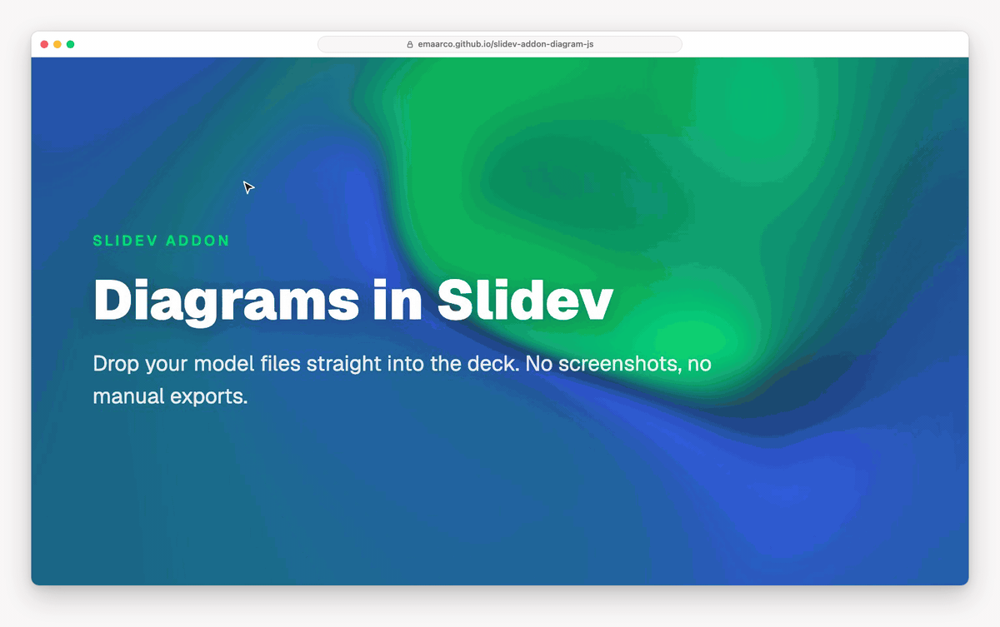

# 📊 slidev-addon-diagram-js

[](https://www.npmjs.com/package/slidev-addon-diagram-js)
[](LICENSE)
[](https://emaarco.github.io/slidev-addon-diagram-js/)



**Show the real model in your slides, not a screenshot of it.**

A [Slidev](https://sli.dev/) addon that renders BPMN processes, DMN decisions, Team Topologies, Wardley Maps and Event Storming boards straight from the files your modeler saves.

## 💡 Why

A screenshot of a process is out of date the moment the model changes, and it cannot show how a token moves or which rule fires. This addon reads the model file itself, so the slide shows the current version, and lets you simulate or edit it in front of the room.

## ✨ What you get

- **Sharp in every export.** The static viewers render to SVG, so diagrams stay crisp in Slidev's PDF and PNG export.
- **Walk the room through it.** Run tokens through a BPMN process, or evaluate a DMN decision with inputs from the audience.
- **Edit mid-talk.** Open a fullscreen modeler from the slide, change the model, and the slide shows the change until you reload the deck.
- **Fits your deck.** Diagrams follow Slidev's dark mode, or you pin them with `theme="light"` or `theme="dark"`.

## 🧩 Supported notations

Each notation has a static viewer for exports and a modeler for live editing; its page lists every component and prop.

| Notation | File | Components | Docs |
|---|---|---|---|
| BPMN 2.0 | `.bpmn` | `<Bpmn>`, `<BpmnTokenSimulation>`, `<BpmnModeler>` | [BPMN](./docs/bpmn.md) |
| DMN 1.3 | `.dmn` | `<DmnDrd>`, `<DmnTable>`, `<DmnSimulate>`, `<DmnModeler>` | [DMN](./docs/dmn.md) |
| Team Topologies | `.tt` | `<TeamTopologies>`, `<TeamTopologiesModeler>` | [Team Topologies](./docs/team-topologies.md) |
| Wardley Maps | `.owm` | `<WardleyMap>`, `<WardleyMapModeler>` | [Wardley Maps](./docs/wardley-maps.md) |
| Event Storming | `.storm` | `<EventStorming>`, `<EventStormingModeler>` | [Event Storming](./docs/event-storming.md) |

## 📦 Install

You need a Slidev deck on Slidev 50 or newer.

```bash
npm install slidev-addon-diagram-js
```

Then add the addon to your deck's frontmatter:

```yaml
---
addons:
  - slidev-addon-diagram-js
---
```

Coming from `slidev-addon-bpmn` or `slidev-addon-dmn`? This package replaces both and your slides need no changes; see the [migration guide](./docs/migrating.md).

## 🚀 Get started

1. Put a diagram file into your deck's `public/` folder, for example `public/order.bpmn`.
2. Add its component to a slide: `<Bpmn bpmnFilePath="/order.bpmn" height="400px" />`.
3. Run `slidev` and the slide shows your process.

The [live demo deck](https://emaarco.github.io/slidev-addon-diagram-js/) shows every component in action.

## 🙋 Help and feedback

- **Documentation:** every component and its props are on the notation's page, linked in the table above.
- **Bugs and ideas:** [open an issue](https://github.com/emaarco/slidev-addon-diagram-js/issues).

## 🤝 Contributing

Bug reports, ideas and pull requests are welcome. How to run the example deck, test and release the addon is in [CONTRIBUTING.md](./CONTRIBUTING.md).

## 🙏 Credits

- [bpmn-js](https://github.com/bpmn-io/bpmn-js), [dmn-js](https://github.com/bpmn-io/dmn-js) and [diagram-js](https://github.com/bpmn-io/diagram-js) by [bpmn.io](https://bpmn.io/)
- The Team Topologies, Wardley Maps and Event Storming renderers by [Miragon](https://github.com/Miragon)
- Inspired by [slidev-addon-excalidraw](https://github.com/haydenull/slidev-addon-excalidraw)

## 📄 License

[MIT](./LICENSE) © Marco Schäck
