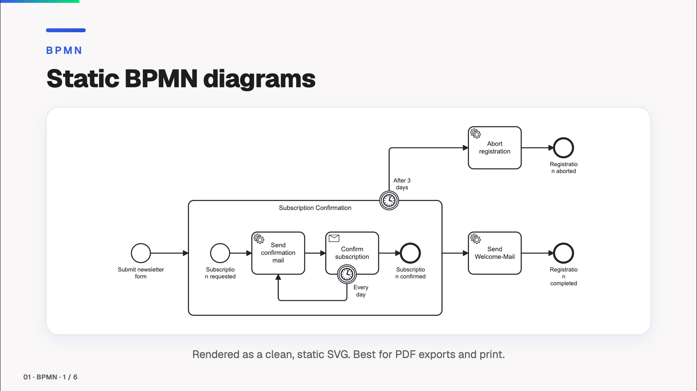

# BPMN

[← Back to the overview](../README.md)



Four components for BPMN 2.0 processes: a static viewer for exports, an animated token simulation for walkthroughs, a path simulation for what-if questions, and a live modeler for workshops.

## `<Bpmn>` — Static viewer

Renders BPMN diagrams as static SVG images. Perfect for PDF exports and presentations.

```vue
<Bpmn
  bpmnFilePath="./my-process.bpmn"
  width="100%"
  height="400px"
/>
```

**Props:**

| Name | Type | Default | Description |
|------|------|---------|-------------|
| `bpmnFilePath` | `string` | *required* | Path to the `.bpmn` file (relative to `public/`) |
| `width` | `string` | `'100%'` | Maximum width of the diagram |
| `height` | `string` | `'auto'` | Height of the diagram |
| `theme` | `'light' \| 'dark'` | the deck's mode | Unset, the diagram follows the deck: dark while `<html>` has the `dark` class (Slidev's dark mode), light otherwise, redrawn when it switches. `'light'` or `'dark'` pins it. `'dark'` draws strokes and labels light on transparent fills, for dark slides. Colours set on elements in the model are kept. |

## `<BpmnTokenSimulation>` — Token simulation

Renders interactive BPMN diagrams with token simulation capabilities. Perfect for process walkthroughs and training — step through the execution with an animated token flow.

With an `engine` and a scenario file the token simulation runs with data, via [`@emaarco/bpmn-js-data-simulation`](https://github.com/emaarco/bpmn-js-data-simulation): ▶ on a start event opens a dialog prefilled from a scenario, and the engine's conditions decide instead of a click. Exclusive and inclusive gateways route by their conditions, an activity with conditional outgoing flows takes every true one (Camunda 7; Zeebe refuses such a model, so the token stops there), and a parallel or sequential multi-instance activity runs once per item of its collection, or `loopCardinality` times.

```vue
<BpmnTokenSimulation bpmnFilePath="./bike-order.bpmn" engine="zeebe" scenariosFilePath="./bike-order.scenarios.json" />
```

```vue
<BpmnTokenSimulation
  bpmnFilePath="./my-process.bpmn"
  width="100%"
  height="500px"
/>
```

**Props:**

| Name | Type | Default | Description |
|------|------|---------|-------------|
| `bpmnFilePath` | `string` | *required* | Path to the `.bpmn` file (relative to `public/`) |
| `width` | `string` | `'100%'` | Width of the diagram container |
| `height` | `string` | `'auto'` | Height of the diagram container (defaults to 500px when 'auto') |
| `fullscreen` | `boolean` | `true` | Show the button that expands the simulation to fullscreen |
| `engine` | `'zeebe' \| 'camunda7'` | — | With `scenariosFilePath`: runs the data simulation, reading FEEL (Zeebe) or the JUEL subset (Camunda 7) |
| `scenariosFilePath` | `string` | — | With `engine`: the [scenario file](https://github.com/emaarco/bpmn-js-data-simulation/blob/main/docs/scenarios.md) the start dialog is prefilled from, including the items a multi-instance collection runs over |
| `theme` | `'light' \| 'dark'` | the deck's mode | Unset, the diagram follows the deck: dark while `<html>` has the `dark` class (Slidev's dark mode), light otherwise, redrawn when it switches. `'light'` or `'dark'` pins it. `'dark'` draws strokes and labels light on transparent fills, for dark slides. Colours set on elements in the model are kept. The fullscreen view stays light. |
| `maxScale` | `number` | `2` | Cap on how far a small diagram is enlarged past its native size. Lower keeps it smaller; higher lets it fill more. |
| `propertiesPanelOpen` | `boolean` | `false` | Shows the properties panel expanded when the modeler opens. It starts collapsed by default; the toolbar button toggles it either way. |

## `<BpmnPathSimulation>` — Path simulation

Shows which path a process takes for given data, without a token or an instance: the exclusive and inclusive gateways evaluate their conditions at once, the path is drawn in blue and everything off it fades. Change a variable and the path follows. It uses the path simulation of [`@emaarco/bpmn-js-data-simulation`](https://github.com/emaarco/bpmn-js-data-simulation/blob/main/docs/usage.md#path-simulation-what-if) and needs no token simulation, so it also fits a narrow column.

```vue
<BpmnPathSimulation
  bpmnFilePath="./bike-order.bpmn"
  engine="zeebe"
  :variables="{ orderTotal: 6800, creditworthy: true }"
  height="300px"
/>
```

Below the diagram, a control for every variable the conditions read lets you change the data live: a switch for a boolean, a slider for a number (up to twice the largest number it is compared with), a text field otherwise. Start from a scenario file instead of `variables` and a dropdown switches between its scenarios:

```vue
<BpmnPathSimulation bpmnFilePath="./bike-order.bpmn" scenariosFilePath="./bike-order.scenarios.json" />
```

For a fixed story, give `steps`: every slide click applies the next set of variables, so the path changes click by click and the PDF export shows each step:

```vue
<BpmnPathSimulation
  bpmnFilePath="./bike-order.bpmn"
  :variables="{ orderTotal: 1290, creditworthy: true, approved: true, insurance: false, accessories: [] }"
  :steps="[{ orderTotal: 6800 }, { insurance: true, accessories: ['lock'] }]"
  controls="none"
/>
```

Like the data simulation, the path follows conditional flows that leave an activity: every true one is taken. Mappings and task results are not applied along the path, so pass every variable the conditions read (a scenario's task results are run through the output mappings once, when it is picked). A gateway that cannot decide, because a variable is missing or a condition cannot be evaluated, stops the path and turns red; a notice below the diagram says why.

**Props:**

| Name | Type | Default | Description |
|------|------|---------|-------------|
| `bpmnFilePath` | `string` | *required* | Path to the `.bpmn` file (relative to `public/`) |
| `engine` | `'zeebe' \| 'camunda7'` | `'zeebe'` | How conditions are read: FEEL for Zeebe, the JUEL subset for Camunda 7 |
| `variables` | `object` | `{}` | The variables to start from. A scenario overrides them. |
| `scenariosFilePath` | `string` | — | A [scenario file](https://github.com/emaarco/bpmn-js-data-simulation/blob/main/docs/scenarios.md) to start from its first scenario, with a dropdown when it holds several; its first entry, "No data", empties the controls |
| `scenario` | `string` | — | The scenario to start from, by id; `'none'` starts on "No data": every control unset and the diagram unmarked, so the model can be explained first. The path grows with each value set; a gateway that still waits for a value ends it without a notice. A scenario picked later fills the controls |
| `controls` | `'auto' \| 'none' \| string[]` | `'auto'` | Which variables get a control: every variable the conditions read, none, or the listed ones |
| `ranges` | `Record<string, { min?, max?, step? }>` | — | Fixed slider bounds per variable, e.g. `{ screeningScore: { max: 100 } }`; without them a slider spans up to twice the largest number the variable is compared with |
| `steps` | `object[]` | — | Variables applied one slide click after the other, each on top of the ones before |
| `width` | `string` | `'100%'` | Width of the component |
| `height` | `string` | `'400px'` | Height of the diagram; the controls sit below it |
| `maxScale` | `number` | `2` | Cap on how far a small diagram is enlarged past its native size |
| `theme` | `'light' \| 'dark'` | the deck's mode | Unset, the diagram follows the deck. `'dark'` draws the diagram for dark slides and the path in a lighter blue. |

The controls sit in a strip below the diagram, in the deck's font. Put the component in a frame such as the Miragon toolkit's `<DiagramFrame>` and both read as one card. The path colour is `--bds-path-taken`, the fade of everything else `--bds-path-skipped-opacity`. The strip takes its colours from `--bpmn-path-text`, `--bpmn-path-muted`, `--bpmn-path-line`, `--bpmn-path-outline`, `--bpmn-path-field`, `--bpmn-path-accent`, `--bpmn-path-focus`, `--bpmn-path-danger` and `--bpmn-path-danger-surface` (light defaults from the Miragon design system); set them on any ancestor to match a deck theme.

## `<BpmnModeler>` — Live modeler

Embeds an interactive BPMN modeler for live diagram editing. Ideal for workshops, trainings, and collaborative sessions where you build diagrams step by step.

```vue
<BpmnModeler
  bpmnFilePath="./my-process.bpmn"
  width="100%"
  height="500px"
/>
```

Or start with a blank canvas (a single start event):

```vue
<BpmnModeler height="500px" />
```

Pass an `engine` to mount an engine-specific properties panel side-by-side with the canvas, so you can edit Zeebe `taskDefinition`s, Camunda 7 expressions, message names, and other technical attributes live:

```vue
<!-- Camunda 8 / Zeebe -->
<BpmnModeler bpmnFilePath="./my-process.bpmn" engine="zeebe" height="500px" />

<!-- Camunda 7 / Platform -->
<BpmnModeler bpmnFilePath="./my-process.bpmn" engine="camunda7" height="500px" />
```

In fullscreen mode, the panel can be hidden and shown again via the toolbar — handy when you need the full canvas width.

**Props:**

| Name | Type | Default | Description |
|------|------|---------|-------------|
| `bpmnFilePath` | `string` | — | Optional path to a `.bpmn` file (relative to `public/`). Omit for a blank diagram. |
| `width` | `string` | `'100%'` | Width of the modeler container |
| `height` | `string` | `'500px'` | Height of the modeler container |
| `engine` | `'zeebe' \| 'camunda7'` | — | Optional engine. Mounts a `bpmn-js-properties-panel` configured for the chosen engine. Omit for a panel-less modeler. |
| `maxScale` | `number` | `2` | Cap on how far a small diagram is enlarged past its native size (e.g. a lone start event on a blank canvas). Lower keeps it smaller; higher lets it fill more. |
| `tokenSimulation` | `boolean` | `false` | Adds the token simulation to the modeler |
| `transactionBoundaries` | `boolean` | `false` | Overlays Camunda 7 transaction boundaries as bars across the sequence flows, in Miragon blue (`#335DE5`, `#6B8AFF` with `theme="dark"`), overridable via `--transaction-boundary-background-color`. Only takes effect with `engine="camunda7"`. |
| `theme` | `'light' \| 'dark'` | the deck's mode | Unset, the diagram follows the deck: dark while `<html>` has the `dark` class (Slidev's dark mode), light otherwise, redrawn when it switches. `'light'` or `'dark'` pins it. `'dark'` draws strokes and labels light on transparent fills, for dark slides. Colours set on elements in the model are kept. The fullscreen modeler follows: canvas, palette, menus and properties panel. |
